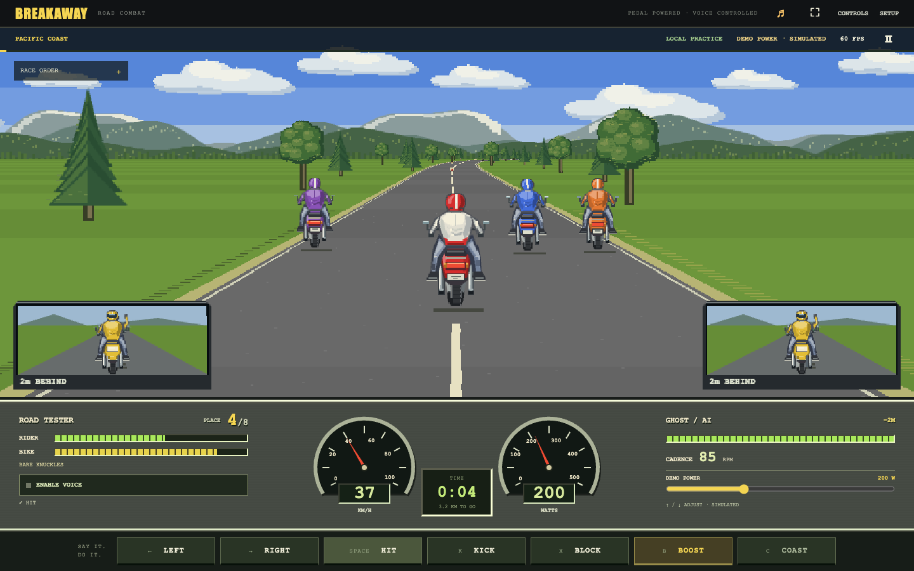

# BREAKAWAY · Road Combat

**Pedal. Speak. Race.** A Genesis-style road-combat racer with original pixel motorcycle sprites, four courses, built-in voice commands, solo AI racing, and an authoritative multiplayer server. Your bike power drives the virtual motorcycle.



## Genesis presentation rebuild

The game now uses a pixel-art two-lane highway, a raised chase camera, shaded rider sprites, live rear-view mirrors, a fixed twin-gauge dashboard, segmented rider/bike meters, nearby-rival condition, and a compact arcade course menu. Solo motion interpolates between physics updates, and rider artwork is cached to keep frames light. Voice can be enabled before the start; say **“start”** to begin solo. **Quick Race** matches riders on this server; **Host Friends** creates a private room. Empty places become AI opponents.

The presentation follows the original Genesis Road Rash composition using newly drawn art and the Breakaway name. Reference: [Genesis gameplay screenshots](https://www.thepixelempire.net/road-rash-smd-review.html). This is a new implementation, not an emulator or a copy of its game assets.

**Current delivery boundary:** local browser play and multiplayer transport are testable here. A public HTTPS server, Android APK build, exact Peloton tablet compatibility, real power input, and real microphone recognition still require setup and physical validation. No public service has been provisioned. Voice means short built-in commands; no ChatGPT Voice Mode or AI API subscription is required.

## Status — read this first

This ZIP contains a **runnable browser game and multiplayer server**, an **Android shell implementation**, tests, deployment configuration, and architecture documentation. It is source release **0.9.0**, not a certified commercial Peloton application.

The browser/server code was executed and tested for this delivery. The Android sensor mapper was compiled and tested as pure Java; all six Java sources also passed syntax parsing (not Android API resolution). **The Android APK was not compiled in the delivery environment; Android SDK/Gradle dependencies and a physical Peloton were unavailable.** Android instrumentation tests, real microphone recognition, firmware compatibility, hardware graphics performance, and extended riding sessions remain release gates. The offline model and Gradle distribution are fetched by the build script; neither is silently represented as bundled or already validated here.

The precise evidence is in [TEST_REPORT.md](docs/TEST_REPORT.md). Passing synthetic tests is not proof that a particular Peloton firmware allows installation or exports usable sensor data.

## Play immediately

Open **`PLAY-SOLO.html`** at the ZIP's top level (or `dist/PLAY-SOLO.html`). This is a self-contained game, not a screenshot: choose a course, press **Solo Race**, and race seven AI riders. Use the demo-power slider or ↑ / ↓ to pedal virtually.

The double-click build is solo only. Use the server below for multiplayer, phone pairing, and normal browser microphone permission flows.

## Run the game and multiplayer server

Install Node.js **22 or newer**, open a terminal in this folder, and run:

```sh
npm start
```

Open **http://localhost:8787**. No `npm install`, database service, cloud API key, or paid AI provider is required for browser/server operation. `START-SERVER.command` and `START-SERVER.bat` provide equivalent launchers.

For a local multiplayer test, open another browser profile or a private window. Create a private room, share its six-character code, have each rider press **I'm ready**, and let the host start. Empty slots become AI riders. Quick Race creates or joins a matching course/balance lobby and starts after ten seconds. **Watch** joins a room as a spectator.

The default server binds loopback only. Internet/phone use requires proper hosting and HTTPS; [DEPLOYMENT.md](docs/DEPLOYMENT.md) covers the included Docker + Caddy setup. Opening port 8787 directly to the internet is not the deployment procedure.

## Ride with your voice

Click **Enable Voice Control** on the course menu (or **Enable Voice** during a race), read the audio-processing choice, grant microphone permission, and speak short commands:

| Voice | Keyboard | Effect |
| --- | --- | --- |
| Left / right / center | ← / → | One lane per command; center returns to middle |
| Hit / kick | Space / K | Attack an adjacent rider within reach |
| Block | X | Temporary defense and one-hazard absorption |
| Boost | B | Spend stamina for a short acceleration burst |
| Coast / resume | C / R | Stop / restore virtual propulsion |
| Ready / start | Lobby buttons | Ready up; host starts a private race |

Voice setup can require the **“rider”** prefix. It uses final results, confidence filtering, utterance de-duplication, and action cooldowns. **Settings → Check voice commands** runs a six-command recognition check; it does not train a personal model.

The Android shell uses local Vosk first. Browser speech and the optional Android platform fallback may involve their speech provider's servers and require consent. The race server receives commands, never audio. Voice stops when the app becomes inactive. See [VOICE.md](docs/VOICE.md).

## Peloton installation and telemetry

Build on a machine with Python 3.11+, Node 22+, JDK 17, and Android SDK 36:

```sh
python scripts/prepare_android.py
```

The script builds the web assets, obtains the offline English model, verifies the Gradle distribution checksum, runs Android JVM tests, and assembles a debug APK. First download needs internet access. Retain `android/model-lock.json` after reviewing the initial model download; later builds check its digest.

The resulting path is `android/app/build/outputs/apk/debug/app-debug.apk`. After enabling USB debugging on your own compatible tablet:

```sh
adb devices
adb install -r android/app/build/outputs/apk/debug/app-debug.apk
```

The debug package is `com.breakaway.race.debug`. It installs alongside Peloton; it does not replace system apps, require root, unlock classes, or control physical resistance. In the Android game, open Settings and set your HTTPS multiplayer-server origin.

**Do not assume every tablet has an accessible microphone, compatible WebView, or sideloading permission.** The shell checks capabilities, tries both documented sensor-service paths, requires real frames before reporting live data, polls a read-only fallback after silence, and fails safely when services disappear. Older or locked firmware may require playing on another screen with a supported Bluetooth power meter/bike. No firmware-unlock exploit or universal compatibility claim is included. See [COMPATIBILITY.md](docs/COMPATIBILITY.md) and [HARDWARE_ACCEPTANCE.md](docs/HARDWARE_ACCEPTANCE.md).

## Included implementation

| Area | Implemented behavior |
| --- | --- |
| Racing | Four tracks, deterministic fixed-step physics, power/equalized modes, drafting, lane contact, AI difficulty, countdown, finish order, DNF recovery |
| Combat | Hits, kicks, chains, timed blocks, boosts, armor, crash recovery, repair/stamina pickups, barriers and oil |
| Presentation | Original pixel-art Canvas road projection, animated motorcycle sprites, twin instrument gauges, rival/condition meters, music/SFX synthesis, responsive arcade menus, reduced effects, render-quality controls |
| Multiplayer | Eight-rider rooms, quick match, private codes, spectators, host/ready rules, authenticated HTTP/SSE, reconnection, input sequencing, stable race IDs, rematches |
| Voice | Native offline engine, optional platform/browser recognition, confidence/duplicate gates, wake prefix, command check, denial/absence handling, paired phone remote |
| Device isolation | Validated telemetry mux, stale-data coasting, Peloton read-only V1/Bike probes and polling, browser BLE Cycling Power / FTMS decoders, diagnostics |
| Progression | Local XP, achievements, jersey unlocks, source-separated personal records, server unverified times, CSV/JSON exports |
| Operations | Bounded sessions/rooms, rate limits, payload limits, origin checks, restrictive native bridge, deployment files, CI workflows, test evidence and release checklist |

This does **not** include paid classes/video sideloading, physical haptics/resistance automation, prizes or verified esports rankings, a managed hosting account, a globally replicated matchmaking service, user billing, voice chat, or copied commercial-game assets. Server sessions and in-progress races are ephemeral across server restarts; career data is local to the browser/device.

## Develop and verify

```sh
npm run verify          # Syntax checks, Node tests, build
npm run test:coverage   # Node built-in coverage
npm run test:load       # Real HTTP/SSE localhost load run
python scripts/test_java.py

# Optional rendered UI tests:
python -m pip install playwright==1.55.0
python -m playwright install chromium
npm run test:e2e

# Or use the Node Playwright suites (optional playwright installation):
# npm install --no-save playwright
npm run test:ui
npm run test:combat-voice   # Synthetic recognized commands → real solo actions
npm run test:combat-render  # Combat visibility/art/performance; needs npm start
npm run test:combat-network # Real HTTP/SSE command timing; needs npm start
npm start                      # keep running in a separate terminal
npm run test:multiplayer-ui
```

`CHROMIUM_PATH` selects an existing Chromium executable. The Node suites also accept `PLAYWRIGHT_MODULE` pointing to an already installed Playwright module and `RACE_URL` for an alternate local server. UI tests use an in-memory HTML document, synthetic native events, and an accelerated clock for the full-race case; the report labels these conditions.

## Project map

```text
client/                 Game, renderer, audio, menus, voice, device and network clients
shared/                 Deterministic simulation, protocol, telemetry/voice validation
server/                 HTTP/SSE authority, rooms, pairing, journal, security
android/                Secure WebView shell, offline voice, read-only sensor adapters
scripts/                Build, Android preparation, checks and browser/load tests
tests/                  Node unit and actual-server integration tests
ops/                    HTTPS reverse proxy configuration
.github/workflows/      Verification and Android build workflows
docs/                   Architecture, protocol, firmware strategy and release gates
artifacts/              Executed test reports and actual rendered screenshots
```

[Architecture](docs/ARCHITECTURE.md) · [Game design](docs/GAME_DESIGN.md) · [Wire protocol](docs/PROTOCOL.md) · [Security](SECURITY.md) · [Upload to GitHub](docs/UPLOAD.md)

Keep your hands on the bars. Virtual “coast” is not a physical emergency stop; use the bike's own controls and stop pedaling when necessary.
